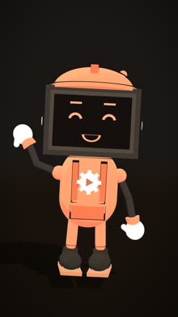
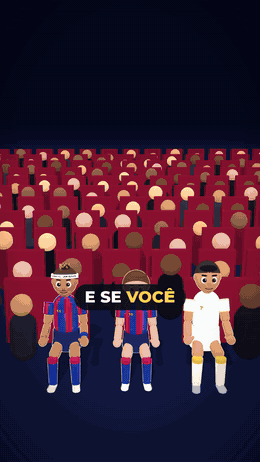
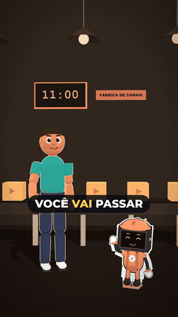
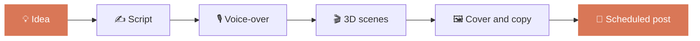
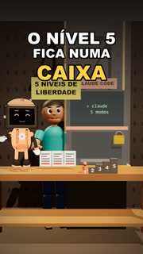
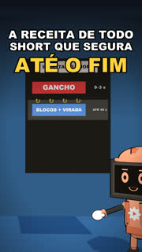
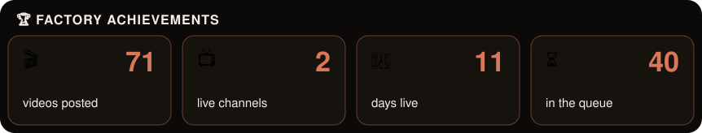

<a href="README.md">🇧🇷 Português</a> · <b>🇺🇸 English</b>

  
  
  
  

<!-- numeros:inicio -->
 
<!-- numeros:fim -->

<!-- marco:inicio -->

<!-- marco:fim -->

---

## 👋 Hi, I'm Rebite

<!-- rebite:inicio -->

<!-- rebite:fim -->

**Fábrica de Canais** (Portuguese for "Channel Factory") is a set of Claude Code skills that makes short videos on its own, from scratch to a scheduled post:

- 💡 **Ideas**: 30 topics from the channel's profile sheet
- ✍️ **Script**: hook, twists and a closing question in 60 s
- 🎙️ **Voice-over**: AI voice that sounds natural
- 🎬 **3D animation**: scenes, music, sound effects and cover
- 📅 **Publishing**: YouTube Shorts, TikTok and Reels on the same day

 

## 🎥 Made by the factory

**Not a single frame of these videos was edited by hand.** The factory took the idea from the queue, wrote the script, generated the voice-over, built the 3D scenes, added music and captions, rendered it and scheduled the post.

<table>
<tr>
<td align="center" width="50%">
  
   <b>⚽ @boleiro3d</b> football as a cartoon
</td>
<td align="center" width="50%">
  
   <b>🏭 @afabricadecanais</b> behind the scenes of the factory
</td>
</tr>
</table>

> The channels and videos are in Brazilian Portuguese.

## ⚙️ How it works

## 📺 Latest posted videos

<!-- ultimos:inicio -->
<table><tr>
<td align="center" width="25%"> Sua narração com IA soa robótica Faz isso</td>
<td align="center" width="25%"> Aparecer no vídeo ou usar um personagem</td>
<td align="center" width="25%"> A receita de todo Short que segura até o fim</td>
<td align="center" width="25%"> A IA que dá nota pro seu roteiro</td>
</tr></table>
<!-- ultimos:fim -->

## 📦 The pack

  

## ❓ FAQ

<b>Do I need to pay for Claude?</b>

 
No. The skills work on the free Claude.ai plan, and the prompts in the PDF work on free ChatGPT and Gemini.

<b>Does it work for any niche?</b>

 
Yes. The channel profile sheet adapts everything to your topic, and the PDF has ready-made ideas for 10 niches.

<b>How do I get it?</b>

 
Instantly, through Kiwify: a .zip with the PDF, the install guide and the 7 skills in two versions (Claude.ai and Claude Code).

<b>Does the AI get facts wrong?</b>

 
It can. That's why every script lists the facts to double-check, and the reviewer flags anything that looks doubtful.

<b>Can I use it for clients?</b>

 
You can use the skills in client work. You just can't resell or share the pack.

<b>What if I don't like it?</b>

 
7-day guarantee through Kiwify: request a refund right on the platform, no questions asked.

> The pack content is in Brazilian Portuguese.

## 🛠️ Built with

  
  
  
  
  

## 📊 Activity

  
    
  
  
    
  

