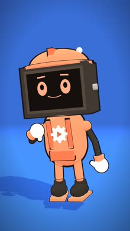
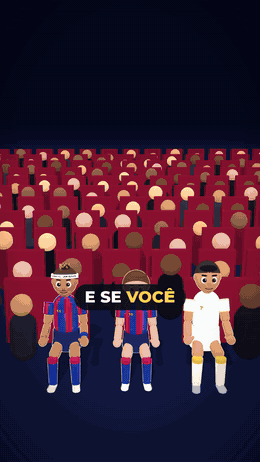
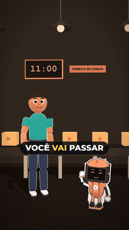
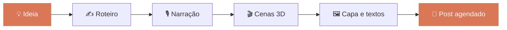
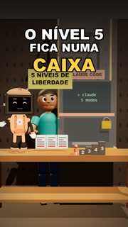
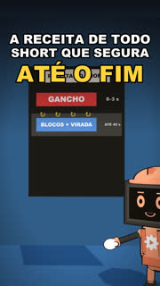
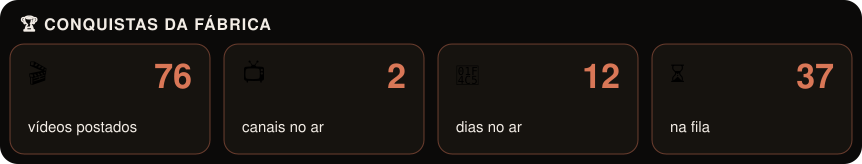

<b>🇧🇷 Português</b> · <a href="README.en.md">🇺🇸 English</a>

  
  
  
  

<!-- numeros:inicio -->
 
<!-- numeros:fim -->

<!-- marco:inicio -->

<!-- marco:fim -->

---

## 👋 Oi, eu sou o Rebite

<!-- rebite:inicio -->

<!-- rebite:fim -->

A **Fábrica de Canais** é um conjunto de skills para o Claude Code que cria vídeos curtos sozinho, do zero até o post agendado:

- 💡 **Ideias**: 30 pautas a partir da ficha do canal
- ✍️ **Roteiro**: gancho, viradas e pergunta final em 60 s
- 🎙️ **Narração**: voz de IA que soa natural
- 🎬 **Animação 3D**: cenas, trilha, efeitos e capa
- 📅 **Publicação**: YouTube Shorts, TikTok e Reels no mesmo dia

 

## 🎥 Feito pela fábrica

**Nenhum quadro destes vídeos foi editado à mão.** A fábrica pegou a ideia da fila, escreveu o roteiro, gerou a narração, montou as cenas 3D, colocou trilha e legenda, renderizou e agendou o post.

<table>
<tr>
<td align="center" width="50%">
  
   <b>⚽ @boleiro3d</b> futebol em desenho animado
</td>
<td align="center" width="50%">
  
   <b>🏭 @afabricadecanais</b> os bastidores da fábrica
</td>
</tr>
</table>

## ⚙️ Como funciona

## 📺 Últimos vídeos postados

<!-- ultimos:inicio -->
<table><tr>
<td align="center" width="25%"> Sua narração com IA soa robótica Faz isso</td>
<td align="center" width="25%"> Aparecer no vídeo ou usar um personagem</td>
<td align="center" width="25%"> A receita de todo Short que segura até o fim</td>
<td align="center" width="25%"> A IA que dá nota pro seu roteiro</td>
</tr></table>
<!-- ultimos:fim -->

## 📦 O pack

  

## ❓ Perguntas frequentes

<b>Preciso pagar o Claude?</b>

 
Não. As skills funcionam no plano grátis do Claude.ai, e os prompts do PDF funcionam no ChatGPT e no Gemini grátis.

<b>Funciona em qualquer nicho?</b>

 
Sim. A ficha do canal adapta tudo ao seu tema, e o PDF traz ideias prontas para 10 nichos.

<b>Como recebo?</b>

 
Na hora, pela Kiwify: um .zip com o PDF, o guia de instalação e as 7 skills em duas versões (Claude.ai e Claude Code).

<b>A IA erra fatos?</b>

 
Pode errar. Por isso o roteiro sempre lista os fatos a conferir e o revisor aponta o que parece duvidoso.

<b>Posso usar para clientes?</b>

 
Pode usar as skills no trabalho para clientes. Só não pode revender ou compartilhar o pack.

<b>E se eu não gostar?</b>

 
Garantia de 7 dias pela Kiwify: você pede o reembolso direto na plataforma, sem precisar explicar.

## 🛠️ Feito com

  
  
  
  
  

## 📊 Atividade

  
    
  
  
    
  

